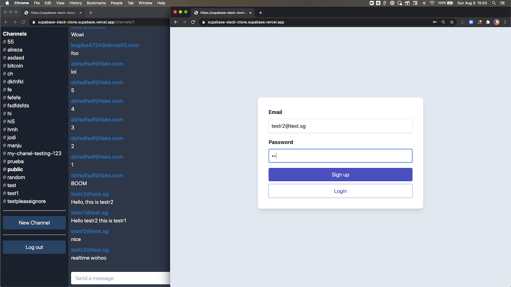

> Tofu's copy of the folder `examples/slack-clone/nextjs-slack-clone` of [supabase/supabase](https://github.com/supabase/supabase) at commit [`7e866ef83e89e35cdda45a6c98abd069d5fa1b2f`](https://github.com/supabase/supabase/tree/7e866ef83e89e35cdda45a6c98abd069d5fa1b2f/examples/slack-clone/nextjs-slack-clone), with the repository's `LICENSE` (Apache-2.0) beside it. The branch `main` holds the folder unchanged; this branch, `tofu`, changes it to run on Tofu, and [TOFU.md](./TOFU.md) says what changed and why. Tofu changed this README on 2026-10-25: this line and the two sections marked below.

# Realtime chat example using Supabase

This is a full-stack Slack clone example using:

- Frontend:
  - [Next.js](https://github.com/vercel/next.js) - a React framework for production.
  - [Supabase.js](https://supabase.com/docs/library/getting-started) for user management and realtime data syncing.
- Backend:
  - [supabase.com/dashboard](https://supabase.com/dashboard/): hosted Postgres database with restful API for usage with Supabase.js.

## Demo

- CodeSandbox: https://codesandbox.io/s/github/supabase/supabase/tree/master/examples/nextjs-slack-clone



## Deploy with Vercel

The Vercel deployment will guide you through creating a Supabase account and project. After installation of the Supabase integration, all relevant environment variables will be set up so that the project is usable immediately after deployment 🚀

[](https://vercel.com/new/clone?repository-url=https%3A%2F%2Fgithub.com%2Fsupabase%2Fsupabase%2Ftree%2Fmaster%2Fexamples%2Fslack-clone%2Fnextjs-slack-clone&project-name=supabase-nextjs-slack-clone&repository-name=supabase-nextjs-slack-clone&integration-ids=oac_VqOgBHqhEoFTPzGkPd7L0iH6&external-id=https%3A%2F%2Fgithub.com%2Fsupabase%2Fsupabase%2Ftree%2Fmaster%2Fexamples%2Fslack-clone%2Fnextjs-slack-clone)

## Build from scratch

### 1. Create new project

Sign up to Supabase - [https://supabase.com/dashboard](https://supabase.com/dashboard) and create a new project. Wait for your database to start.

### 2. Run "Slack Clone" Quickstart

Once your database has started, run the "Slack Clone" quickstart.


### 3. Get the URL and Key

Go to the Project Settings (the cog icon), open the API tab, and find your API URL and `anon` key. You'll need these in the next step.

The `anon` key is your client-side API key. It allows "anonymous access" to your database, until the user has logged in. Once they have logged in, the keys will switch to the user's own login token. This enables row level security for your data. Read more about this [below](#postgres-row-level-security).


**_NOTE_**: The `secret` key has full access to your data, bypassing any security policies. These keys have to be kept secret and are meant to be used in server environments and never on a client or browser.

## Supabase details

### Using a Remote Supabase Project

1. Create or select a project on [Supabase Dashboard](https://supabase.com/dashboard).
2. Copy and fill the dotenv template `cp .env.production.example .env.production`
3. Link the local project and merge the local configuration with the remote one:

```bash
SUPABASE_ENV=production npx supabase@latest link --project-ref <your-project-ref>
```

3. Sync the configuration:

```bash
SUPABASE_ENV=production npx supabase@latest config push
```

4. Sync the database schema:

```bash
SUPABASE_ENV=production npx supabase@latest db push
```

## Vercel Preview with Branching

Supabase integrates seamlessly with Vercel's preview branches, giving each branch a dedicated Supabase project. This setup allows testing database migrations or service configurations safely before applying them to production.

### Steps

1. Ensure the Vercel project is linked to a Git repository.
2. Configure the "Preview" environment variables in Vercel:
   - `NEXT_PUBLIC_SUPABASE_URL`
   - `NEXT_PUBLIC_SUPABASE_PUBLISHABLE_KEY`

3. Create a new branch, make changes (e.g., update `max_frequency`), and push the branch to Git.
   - Open a pull request to trigger Vercel + Supabase integration.
   - Upon successful deployment, the preview environment reflects the changes.


---

### Role-based access control (RBAC)

(Tofu changed this section.) Each person's role is a row in `public.app_members`, by email address: `admin`, `member` or `viewer`. The first account made in the app becomes its `admin`, and every account after it a `member`. Admins can delete all messages and channels (the app offers no way to delete the `public` channel); members post, make channels and delete their own; viewers can read but not post; nobody can edit a message once it is posted. A role follows its person when they change their email address, and a new account never takes over a role left on its address. Upstream gave the `admin` and `moderator` roles to any address containing `+supaadmin@` or `+supamod@`, which let anyone promote themselves.

### Postgres Row level security

This project uses very high-level Authorization using Postgres' Row Level Security.
When you start a Postgres database on Supabase, we populate it with an `auth` schema, and some helper functions.
When a user logs in, they are issued a JWT with the role `authenticated` and their UUID.
We can use these details to provide fine-grained control over what each user can and cannot do.

- For the full schema refer to [supabase/migrations](./supabase/migrations) (Tofu changed this line: `full-schema.sql` is gone, as TOFU.md says).
- For documentation on Role-based Access Control, refer to the [docs](https://supabase.com/docs/guides/auth/custom-claims-and-role-based-access-control-rbac).

## Authors

- [Supabase](https://supabase.com)

Supabase is open source, we'd love for you to follow along and get involved at https://github.com/supabase/supabase
